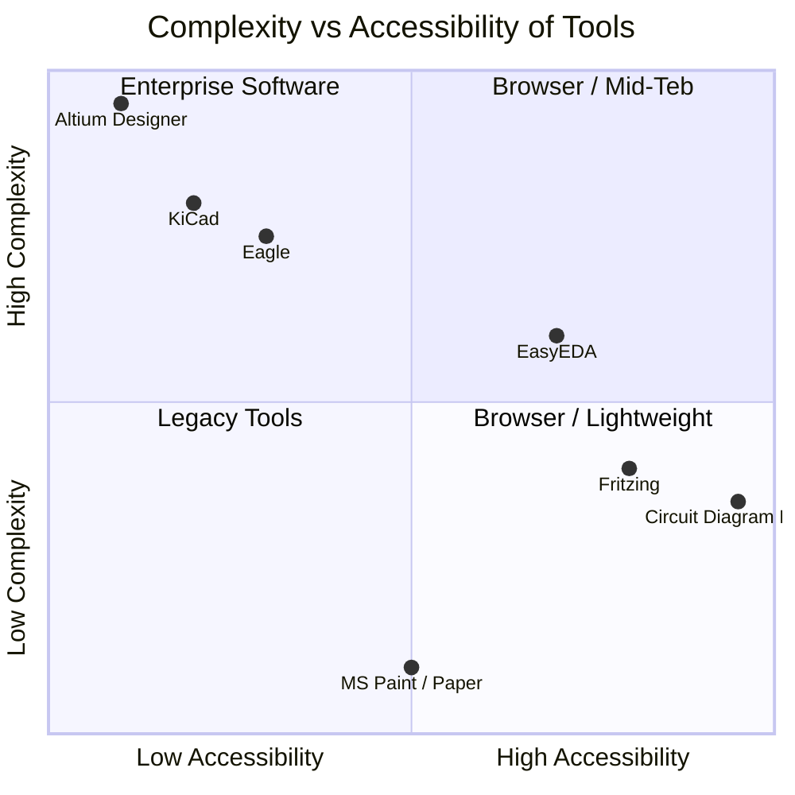
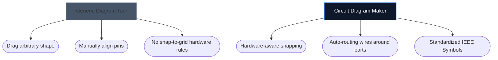

Choosing the right tool to draw your electronics schematics can often dictate how fast you can iterate on a new hardware project. Whether evaluating heavyweight CAD packages or an agile browser workflow, finding the right [circuit diagram maker](/) helps you design and export schematics faster. While advanced PCB designers require heavyweight desktop environments, hobbyists, students, and makers often need something entirely different: accessibility and speed.

Below, we analyze how our tool stacks up against the main industry alternatives.

## Tool Categorization Matrix

Before diving into individual tools, it is crucial to understand what tier of software your project actually demands. Using enterprise PCB software to sketch a 4-component LED layout is overkill.

## 1. Circuit Diagram Maker vs. Fritzing

Fritzing is famous for bridging the gap between breadboard prototyping and schematics. However, Fritzing requires installation and has struggled with maintenance updates over the years.

| Feature | Circuit Diagram Maker | Fritzing |
| :--- | :--- | :--- |
| **Primary Focus** | Standard Schematic Layouts | Breadboard Visualizations |
| **Installation** | None (100% Browser-based) | Desktop Installation Required |
| **Cost** | 100% Free | Paid (Donationware) |
| **Learning Curve** | Extremely Low | Moderate |

> **The Verdict:** If you specifically need to visualize physics wires plunging into a breadboard, Fritzing is superior. If you need standard, universal electronic schematics *instantly*, use Circuit Diagram Maker.

## 2. Circuit Diagram Maker vs. KiCad & Altium

KiCad is a legendary open-source PCB suite, and Altium Designer is the enterprise industry standard. They are immensely powerful.

| Capability Layer | Circuit Diagram Maker | KiCad / Altium |
| :--- | :--- | :--- |
| **Output Type** | SVG/PNG Imagery | Gerber Files, BOM, Pick&Place |
| **Simulation** | Visual / Simplistic | Deep SPICE Integration |
| **Speed to First Schema** | < 10 seconds | 10–30 Minutes (Setup/Config) |

> **The Verdict:** Use KiCad or Altium when you are sending layers of copper to a factory in Shenzhen. Use Circuit Diagram Maker when you are attaching a schematic to a physics assignment, blog post, or forum question.

## 3. Circuit Diagram Maker vs. draw.io / Lucidchart

Generic diagramming tools like draw.io are incredibly popular for flowcharts. However, they lack semantic understanding of electronics.

When you use a dedicated electronics tool, the editor understands that a wire cannot simply "terminate" randomly without a junction, and it inherently maps standard properties (like Ohms to resistors).

## Comprehensive Feature Comparison Matrix

| Workflow Criteria | Circuit Diagram Maker | KiCad (v8) | Fritzing | draw.io | EasyEDA |
| :--- | :--- | :--- | :--- | :--- | :--- |
| **Platform** | 100% Web Browser | Windows / macOS / Linux | Desktop App | Web / Desktop | Web / Desktop |
| **Initial Setup Time** | **< 5 seconds** | 15–30 minutes | 5–10 minutes | < 1 minute | 2–5 minutes |
| **Target Audience** | Students, Educators, Content Creators | PCB & Hardware Engineers | Beginners, Makers, Arduino | General Flowchart Users | PCB Designers, JLCPCB Users |
| **Component Snapping** | Native electrical grid & terminal snap | Strict footprint pin grid | Breadboard pin snap | Generic boundary snap | Pin-to-pin snap |
| **Wire Orthogonal Routing** | Automatic Manhattan routing | Manual 90° / 45° buses | Manual curves | Basic bezier / orthogonal | Manual schematic nets |
| **Export Formats** | High-Res SVG, Clean PNG, JSON | Gerber, Drill, PDF, DXF, SVG | PNG, PDF, Gerber | PNG, SVG, PDF | Gerber, PDF, BOM |
| **Design Rule Check (DRC)**| Terminal connectivity alerts | Full netlist & footprint DRC | Basic overlap check | None | Full PCB design DRC |
| **Offline Operation** | Cached PWA / Local Storage | 100% Offline Native | 100% Offline Native | Offline Desktop version | Requires cloud account |
| **Cost** | **100% Free** | Free / Open Source (CERN) | €20–€40 (Donationware) | Free | Free tier (Cloud-tied) |

## Workflow Breakdown: When to Use Which Tool

### Choose Circuit Diagram Maker When:
- **Writing technical documentation, blog tutorials, or lab reports**: You need clean, standardized IEEE/IEC schematic figures with transparent backgrounds that scale cleanly in print and responsive web layouts.
- **Teaching electronics fundamentals**: Students can begin laying out circuits on day one without software installations, driver issues, or complex footprint assignments.
- **Drafting conceptual schematics for team reviews**: Quickly share ideas or post diagrams on GitHub, Stack Exchange, or Discord without sending proprietary CAD project files.

### Choose KiCad or Altium Designer When:
- **Manufacturing physical circuit boards**: You need to assign physical SMD/through-hole footprints, route multi-layer copper traces, calculate impedance-matched differential pairs, and export Gerber RS-274X files for PCB fabrication.
- **Simulating circuit performance**: You require SPICE engine simulations (transient analysis, AC sweeps, Monte Carlo tolerance modeling).

### Choose Fritzing When:
- **Creating breadboard assembly guides**: You are teaching complete beginners or younger students who need to physically see which row and column on an actual solderless breadboard each wire plugs into.

### Choose draw.io or Lucidchart When:
- **Creating high-level systems architecture diagrams**: You are mapping block diagrams, network topologies, or mixed software-hardware workflows where electrical terminal semantics are not needed.

## Which Tool is Right for You?

The best tool is the one that gets out of your way. For rapid ideation, educational assignments, documentation, and publication-ready vector exports, [Circuit Diagram Maker](/editor/) delivers the fastest path from idea to clean schematic. When ready for physical board fabrication, take your finalized schematic logic directly into KiCad or EasyEDA. 
