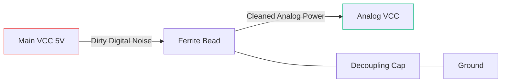

High-speed digital electronics create a lot of electromagnetic noise. Without mitigation, this high-frequency interference bleeds into sensitive analog lines or radiates outward, causing your device to spectacularly fail FCC emissions testing. 

The primary weapon against this interference is the **ferrite bead**. When planning high-speed supply rails, you can [draw circuit diagrams online](/) to verify that filtering beads are placed immediately adjacent to noise-generating IC pins. Understanding its schematic symbol and placement dictates whether your circuit operates cleanly or drowns in its own noise.

## 1. Visualizing the Ferrite Bead Symbol

A ferrite bead operates inherently like a heavily lossy inductor. Because of this, its schematic symbol is closely related to the standard inductor symbol, but tailored to emphasize its specific role.

```mermaid
graph LR
    A[Inductor Basis] --> B(Standard Inductor Symbol)
    A --> C(Rectangle Over Wire)
    B -.-> D(Addition of a dashed line or solid bar)
    D --> E[IEEE Ferrite Symbol]
    C --> F[IEC Ferrite Symbol]
    
    style E fill:#0f172a,stroke:#3b82f6
    style F fill:#0f172a,stroke:#10b981
```

| Trait | IEEE/ANSI Standard | IEC Standard | Notes |
| :--- | :--- | :--- | :--- |
| **Shape** | Series of semi-circles with a bar/box | A solid rectangular block | Functionally identical in outcome |
| **Designator Prefix** | `FB` | `FB` or `L` | Using `FB` is highly recommended to prevent confusion with power inductors |
| **Measurement Unit** | Ohms (Ω) at specific MHz | Ohms (Ω) at specific MHz | Unlike inductors measured in Henries (H) |

> **Crucial Distinction:** Never rate a ferrite bead by inductance. Ferrite beads are specified by their **impedance (in Ohms) at a specific frequency** (typically 100 MHz).

## 2. Core Operational Mechanics

Why use a ferrite bead instead of a standard inductor? 

* An **inductor** stores energy and returns it to the circuit. It is highly reactive and preserves energy.
* A **ferrite bead** is actively designed to be *lossy*. At high frequencies, it behaves like a resistor, converting unwanted high-frequency noise directly into heat.

| Frequency Range | Ferrite Bead Behavior | Result on Circuit |
| :--- | :--- | :--- |
| **Low Frequency / DC** | Under 1 MHz | Acts like a simple wire (~0 Ω). DC power passes through freely. |
| **Resonant Frequency** | Highly Reactive | Stores energy briefly. |
| **High Frequency** | Over 50 MHz+ | Acts like a high-value resistor. Blocks and dissipates RF noise as heat. |

## 3. Best Practices for Schematic Placement

Properly utilizing the FB symbol requires strategic placement. Slapping ferrite beads randomly on a schematic can actually worsen ringing and resonance.

### Decoupling Power Supplies (Pi-Filters)

The absolute most common use for an `FB` symbol is isolating dirty digital power from clean analog power.

In the configuration above (part of a Pi-Filter), the ferrite bead blocks high-frequency transients from entering the AVCC line, while the capacitor shunts any remaining ripple down to ground.

### Data Line EMI Suppression

When routing long USB data cables or HDMI traces, `FB` symbols are often placed in series near the connector. This ensures that the long, physically exposed wire does not act as an antenna and radiate CPU noise across the room.

## 4. Critical Engineering Pitfalls & Selection Guidelines

When selecting and reading ferrite beads in real-world schematics, watch for two subtle traps that cause mystery hardware failures:

### The DC Bias Current Trap (Impedance Derating)
A ferrite bead specified as `600 Ω @ 100 MHz` only delivers that 600 Ω impedance at **zero DC current**. As operating DC current increases toward the rated maximum, internal magnetic domains saturate, causing effective impedance to collapse by 50% to 80%:

| DC Load Current | Effective Impedance (% of Rated) | Design Impact |
| :--- | :--- | :--- |
| **0% Rated Current** | 100% (Full rated 600 Ω) | Maximum noise attenuation |
| **30% Rated Current** | ~75%–85% | Nominal filtering intact |
| **60% Rated Current** | ~40%–50% | Significant high-frequency leakage |
| **90%+ Rated Current** | < 25% | Bead acts virtually as a wire, zero EMI filtering |

*Design Rule:* Always select a ferrite bead whose rated DC current ($I_{DC}$) is at least **2x to 3x** your circuit's peak load current.

### The LC Anti-Resonance Trap
Placing a ferrite bead in series with a ceramic decoupling capacitor creates an effective LC resonant tank. At the resonant frequency ($f_{res} = \frac{1}{2\pi\sqrt{L \cdot C}}$), the circuit may actually **amplify voltage ripple** instead of suppressing it, causing microcontroller reset glitches.

*Remedy:* Add a small damping resistance (either select a bead with high intrinsic DC resistance $R_{DC} \approx 0.1\text{–}0.5\,\Omega$, or parallel the ceramic cap with a lossy electrolytic/tantalum capacitor).

## Real-World Component Selection Guide

| Application Area | Typical Part Spec | Target Frequency Band | Recommended Package |
| :--- | :--- | :--- | :--- |
| **USB 2.0 / 3.0 VBUS** | `120 Ω @ 100 MHz, 2A` | 100 MHz – 500 MHz | 0805 / 1206 SMD |
| **MCU Analog AVCC Rail**| `600 Ω @ 100 MHz, 200mA`| 50 MHz – 1 GHz | 0603 SMD |
| **Switching Regulator Output**| `60 Ω @ 100 MHz, 4A, Low RDC`| 10 MHz – 100 MHz | 1206 / 1210 SMD |
| **Audio Line Filtering** | `1000 Ω @ 100 MHz, 100mA`| 100 MHz – 2 GHz | 0402 / 0603 SMD |

To add a ferrite bead to your next schematic, open the **[Circuit Diagram Editor](/editor/)**, search for "Ferrite," and specify your impedance rating and DC current limits!
