Building a power inverter—converting a 12V car battery into 220V alternating current capable of running household appliances—is a rite of passage for electronics engineers. 

Before lifting a soldering iron, you must achieve a flawless understanding of the underlying schematic. High-voltage circuitry is unforgiving, and a badly drawn diagram guarantees burnt MOSFETs or severe electric shock. Before wiring high-power stages, you can [create electrical circuit diagram online](/) models to double-check driver polarities and transformer taps. This guide breaks down the architecture of a fundamental square-wave inverter.

> **Safety Warning:** 220V AC power is lethal. This article is an exploration of schematic logic and theoretical design, not a manufacturing blue-print. Never build high-voltage circuits without advanced electrical training.

## The Three Pillar Architecture

No matter how complex a modern inverter is, the schematic can always be visually and logically divided into three distinct functional blocks.

```mermaid
flowchart LR
    DC_SRC[(12V DC Battery)] --> OSC[1. Oscillator Block]
    OSC -- Low Power Square Wave --> AMP[2. Power Switch Block]
    AMP -- High Current 12V Wave --> TX[3. Step-Up Transformer]
    TX -- Magnetic Induction --> AC_OUT((220V AC Output))
    
    style OSC fill:#0f172a,stroke:#3b82f6
    style AMP fill:#0f172a,stroke:#f59e0b
    style TX fill:#0f172a,stroke:#ef4444
```

### Stage 1: The Oscillator (The Brains)

Direct Current (DC) from a battery flows in a straight line. Transformers cannot step-up a straight line; they require fluctuating magnetic fields. Therefore, we must convert the DC into an artificial AC wave (typically 50Hz or 60Hz depending on geographic region).

| Component Used | Schematic Role | Why it is Chosen |
| :--- | :--- | :--- |
| **CD4047 IC / 555 Timer** | Astable Multivibrator | Outputs a remarkably stable square wave via calculating an RC time constant. |
| **Resistor & Capacitor Network** | Timing calibrators | Values (e.g., `R=100kΩ`, `C=0.1μF`) uniquely dictate the precise 50Hz frequency. |

### Stage 2: The Power Switches (The Muscle)

The logic chip produces a pristine 50Hz wave, but at exceptionally low current limits (often under 20mA). If you fed that into a transformer, it would not generate enough magnetic flux to run a lightbulb.

We place high-power transistors between the oscillator and the transformer coils. 

1. The oscillator's weak signal hits the **Gate** of a massive N-Channel MOSFET (like the IRF3205).
2. The MOSFET acts as an electronic heavy-duty relay.
3. It furiously switches the massive amperage from the 12V battery directly through the transformer coils 50 times a second.

### Stage 3: The Step-Up Transformer

At this point in the schematic, we have massive amounts of 12V current pulsing back and forth. The final stage requires routing this through the primary coils of a transformer.

| Feature | Schematic Details | Real-world Implication |
| :--- | :--- | :--- |
| **Primary Coil (Left)** | Center-tapped configuration (`12V - 0 - 12V`) | Allows back-and-forth push-pull switching from two alternating MOSFETs. |
| **Core Lines** | Two solid lines drawn vertically | Represents the iron/ferrite core necessary for high-efficiency magnetic induction. |
| **Secondary Coil (Right)** | Massively increased winding ratio | Physics steps the pulsing 12V magnetic flux up into a lethal, volatile 220V wave. |

## Drawing Considerations

When utilizing the **[Circuit Diagram Editor](/editor/)** to draft this design, remember layout best practices:

* Draw the heavy lines carrying the 12V Battery current thicker than the low-power oscillator lines.
* Ground the MOSFET Source pins explicitly and uniquely; do not route them back near the sensitive oscillator ground to prevent noise coupling.
* Delineate the 220V outputs graphically! Place warning labels and output ports (like a socket symbol) rather than leaving bare wires terminating in the void.

## Required Components List

To construct or document a practical 12V to 220V 50Hz square-wave inverter in this schematic configuration, you need the following specified components:

| Reference | Component | Specification | Function |
| :--- | :--- | :--- | :--- |
| **U1** | CD4047B (or 555 Timer) | Low-power CMOS Monostable/Astable Multivibrator | Generates complementary 50Hz square wave outputs (Pins 10 & 11) |
| **Q1, Q2** | IRF3205 / IRLZ44N | N-Channel Power MOSFET (55V, 110A, RDS(on) = 8mΩ) | Power switching stage driven by oscillator signals |
| **T1** | Step-Up Transformer | 12V-0-12V Center-Tapped Primary / 220V Secondary (50Hz Iron Core) | Magnetically steps up alternating 12V pulses to 220V mains level |
| **R1** | Carbon Film Resistor | 100 kΩ, 1/4W (or 100 kΩ multi-turn trimmer) | Calibrates astable oscillation frequency |
| **C1** | Film Capacitor | 0.1 µF (100nF), 50V | Timing capacitor for CD4047 astable oscillation |
| **C2** | Electrolytic Capacitor | 1000 µF, 25V | Decoupling & reservoir capacitor across 12V battery input rails |
| **R2, R3** | Gate Pull-Down Resistors | 10 kΩ, 1/4W | Prevents floating gate states when driver logic is high-impedance |
| **R4, R5** | Gate Series Resistors | 100 Ω to 220 Ω, 1/4W | Dampens parasitic ringing and limits peak gate drive current |
| **F1** | Automotive DC Fuse | 15A to 25A | Critical overcurrent protection on positive 12V battery supply line |

## How the Circuit Works (Detailed Analysis)

1. **Oscillator Operation (CD4047)**:
   - When configured in free-running astable mode (pins 4, 5, 6 tied high; pins 7, 8 tied low/ground), the CD4047 internal flip-flop alternates output states on pin 10 (Q) and pin 11 (Q-bar) with an exact 50% duty cycle.
   - The oscillation frequency at each output pin is governed by the RC time constant: `f = 1 / (4.4 * R1 * C1)`.
   - Substituting R1 = 100 kΩ and C1 = 0.1 µF produces `f ≈ 50 Hz` (or 60 Hz by trimming R1 to ~83 kΩ).

2. **Push-Pull Switching**:
   - When pin 10 is HIGH, MOSFET Q1 conducts, pulling the left half of the transformer's 12V primary winding to ground while Q2 remains non-conductive. Current flows through the left coil in one direction.
   - When pin 11 transitions HIGH (and pin 10 goes LOW), Q1 cuts off and Q2 conducts, pulling the right half of the 12V primary winding to ground. Current flows in the opposite magnetic direction.
   - This push-pull alternation drives a symmetrical, alternating magnetic flux through the transformer's laminated iron core.

3. **Step-Up Induction**:
   - By Faraday's Law of Induction, the alternating magnetic flux induces a corresponding alternating voltage in the high-turn secondary winding. The winding ratio (Ns / Np ≈ 220V / 12V ≈ 18.3) elevates the 12V input pulses to approximately 220V AC.

## Step-by-Step Circuit Connections

1. **Power & Ground Rails**:
   - Connect the 12V DC battery positive terminal through fuse **F1** directly to the transformer's **Center Tap** pin.
   - Connect 12V DC positive to CD4047 Pin 14 (VDD) and Pins 4, 5, 6, 12 (Mode controls tied HIGH).
   - Connect the negative battery terminal to the central ground bus. Connect MOSFET Source terminals directly to this bus using short, heavy-gauge wire.

2. **Timing & Gate Connections**:
   - Connect timing capacitor **C1** across Pins 1 and 3 of U1.
   - Connect resistor **R1** between Pin 2 and Pin 3.
   - Route U1 Pin 10 through gate resistor **R4** to Q1 Gate.
   - Route U1 Pin 11 through gate resistor **R5** to Q2 Gate.
   - Solder gate pull-down resistors **R2** and **R3** directly from each MOSFET Gate to its respective Source.

3. **Transformer & Output**:
   - Connect Q1 Drain to Left Primary Tap.
   - Connect Q2 Drain to Right Primary Tap.
   - Secondary winding output wires connect directly to your isolated 220V AC output load socket.

## Troubleshooting & Common Mistakes

- **MOSFET Overheating**: If transistors run hot without a load, both Q1 and Q2 may be conducting simultaneously (shoot-through) due to floating gates or high gate capacitance. Always verify gate pull-down resistors (10 kΩ) are firmly soldered.
- **Incorrect Frequency (Motor hum / bulb flicker)**: Inaccurate resistor/capacitor tolerances shift frequency away from 50Hz. Use a 1% metal film resistor or trimmer potentiometer for R1 and calibrate with an oscilloscope or multimeter frequency counter.
- **Inductive Voltage Spikes**: When power switches turn off abruptly, primary leakage inductance creates massive flyback spikes. Add RC snubber networks (10 Ω + 0.1 µF, 250V) across each primary winding to ground to protect the MOSFETs.
- **Heavy Load Voltage Drop**: Standard push-pull square wave inverters lack automatic pulse-width feedback regulation; output voltage will naturally droop under heavy resistive loads.

## Technical Limitations & Safe Operating Limits

- **Square-Wave vs. Pure Sine Wave**: This circuit produces a modified square wave, not a clean sinusoidal wave. It is safe for incandescent lighting, simple heaters, and universal AC/DC motor tools. **Do not use this circuit with sensitive medical gear, audio studio equipment, or inductive refrigerator compressor motors**, which require pure sine wave inverters.
- **MOSFET Heatsinking**: When delivering more than 50W, both MOSFETs require substantial aluminum heatsinks mounted with insulating mica washers and thermal paste.
